# AI Interview Platform

<p align="center">
  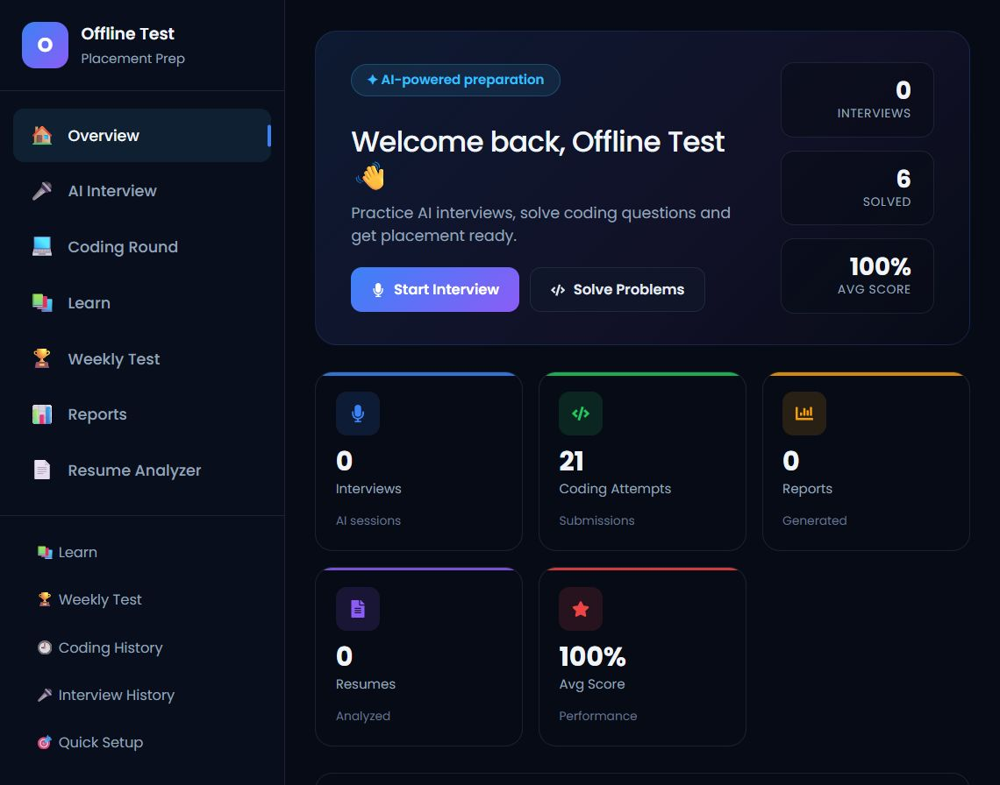
</p>

<p align="center">
  <b>Crack your next interview with AI</b> — live AI mock interviews, a 150-problem coding arena,
  an AI Learn Hub, a proctored Weekly Test and an ATS resume analyzer.
</p>

Full-stack placement-prep platform. React + Vite frontend, Spring Boot backend, OpenRouter AI for the interview engine.

---

## What it does

**🎤 Live AI mock interviews** — Pick a role (Java Full Stack, Backend, Frontend, AI/ML, DevOps, Data Analyst, Product Manager…), experience level, difficulty and focus topics; get voiced AI questions, answer by voice or text, and get an AI-generated score, strengths/weaknesses and an action plan. Full per-session reports are stored for review.

**💻 Coding Round** — 150 curated DSA problems across 30+ topics with difficulty filters. Monaco editor in **Java, Python, JavaScript, C and C++**. Problems ship with visible sample cases and hidden grading cases (up to 60). Code is wrapped in method-only stubs with an auto-generated I/O bridge (you write `public String solve(String input)` semantics, the bridge handles stdin/stdout, C memory, Python lists etc.). One-click **Run** for the samples, **Submit** for the full suite. Built-in AI tools: explain, debug, hints, complexity analysis.

**📚 Learn Hub** — Ask anything ("Explain B-Trees with a Java example") and get an interview-ready lesson in seconds. Voice input, chat-style tutor, quick-topic prompts.

**🏆 Weekly Test** — A timed, proctored coding contest: 3 coding questions (you choose each one's difficulty) + 15 MCQs, webcam presence proctoring (face-api, tiny-face model) and tab-switch auto-submission. Results are stored with per-question scoring.

**📄 Resume Analyzer** — Drop your resume (PDF), get an ATS score, keyword gaps, HR feedback and concrete rewrite suggestions.

**📊 Dashboard & Reports** — Solved counts, average score, daily streak, weekly progress, per-session AI interview reports (score, strengths, weaknesses, recommendations).

## Screenshots

| Dashboard | Coding Round (Two Sum in the judge) | AI Interview |
|---|---|---|
|  | 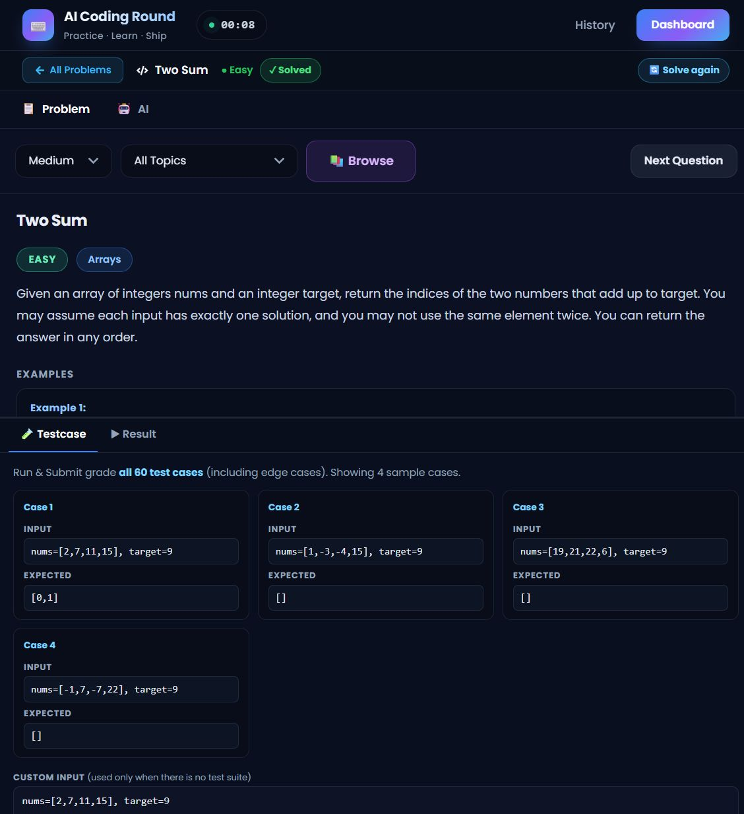 | 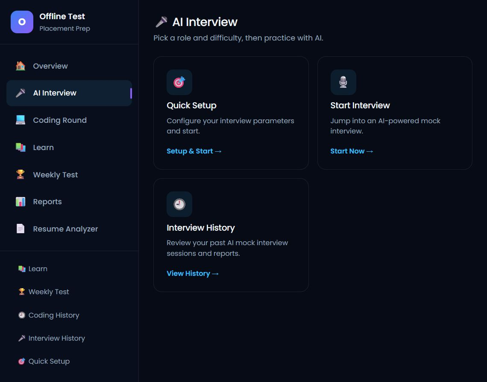 |

| Interview Setup | Interview Report | Learn Hub |
|---|---|---|
| 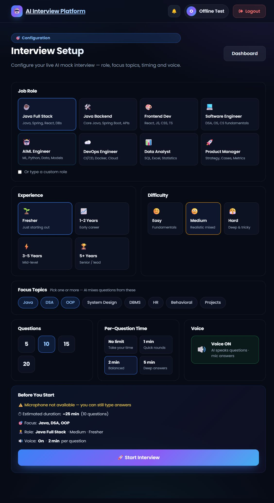 | 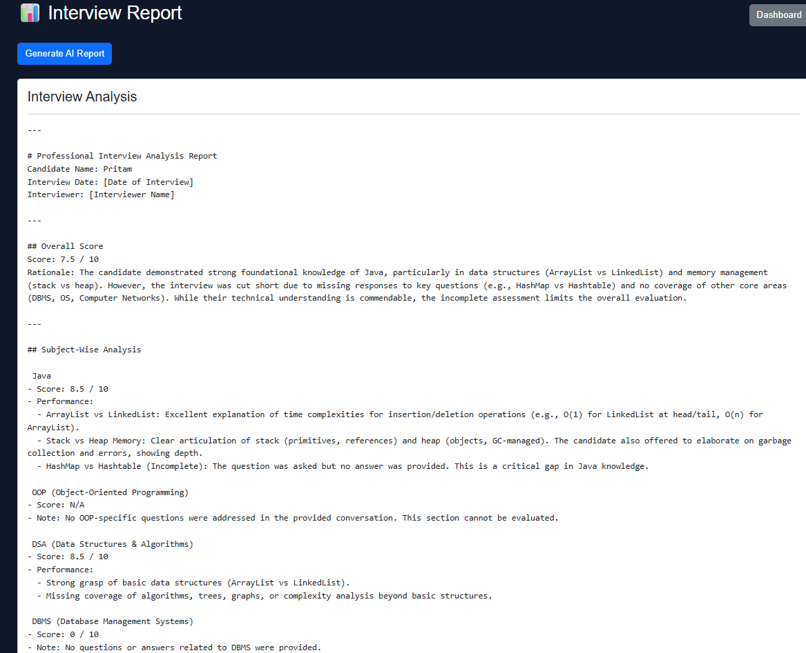 | 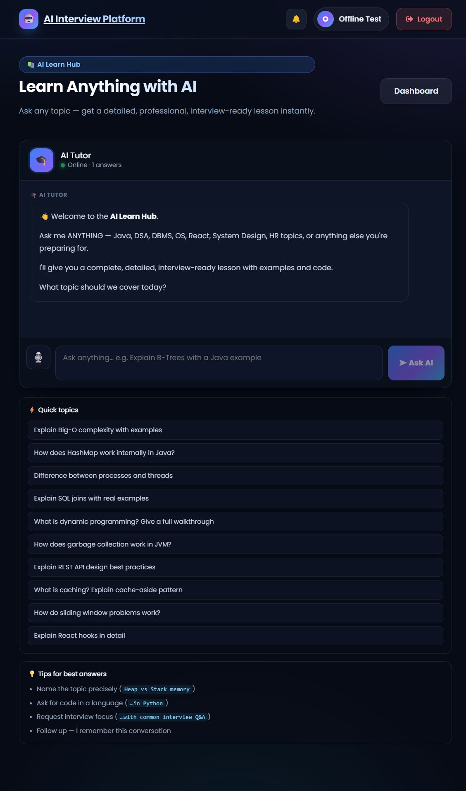 |

| Weekly Test | Resume Analyzer | Reports |
|---|---|---|
| 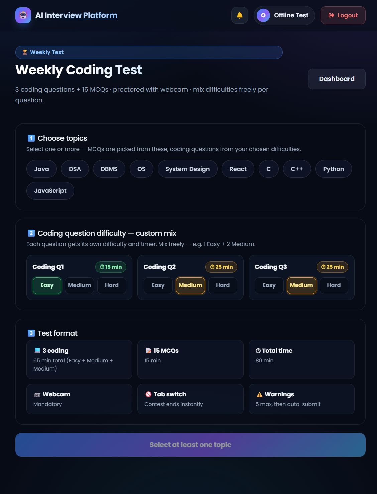 | 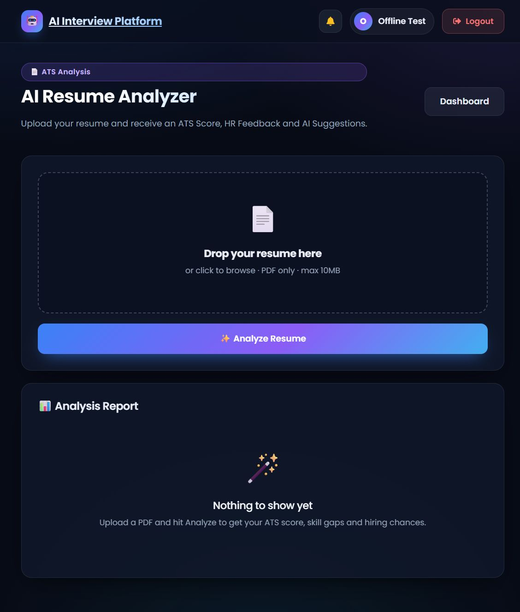 | 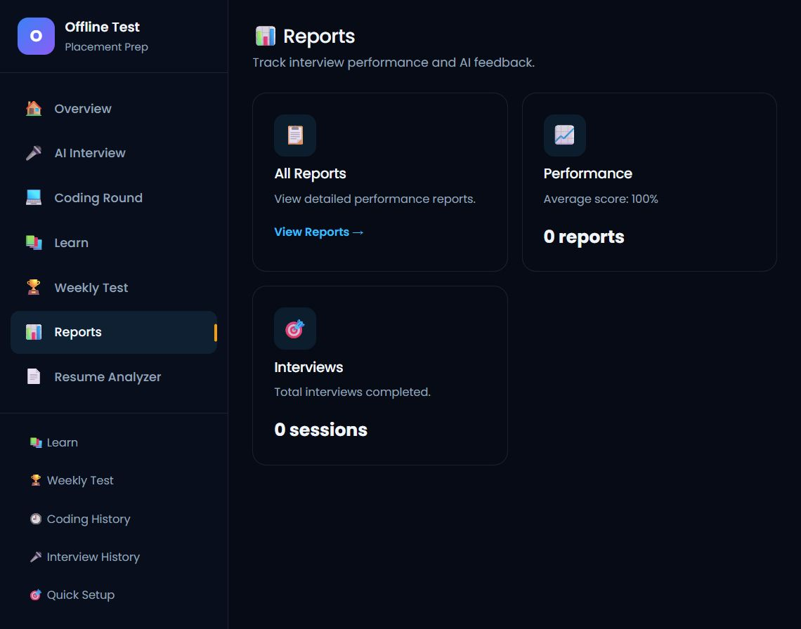 |

| Sign in | Create account | Problem preview |
|---|---|---|
| 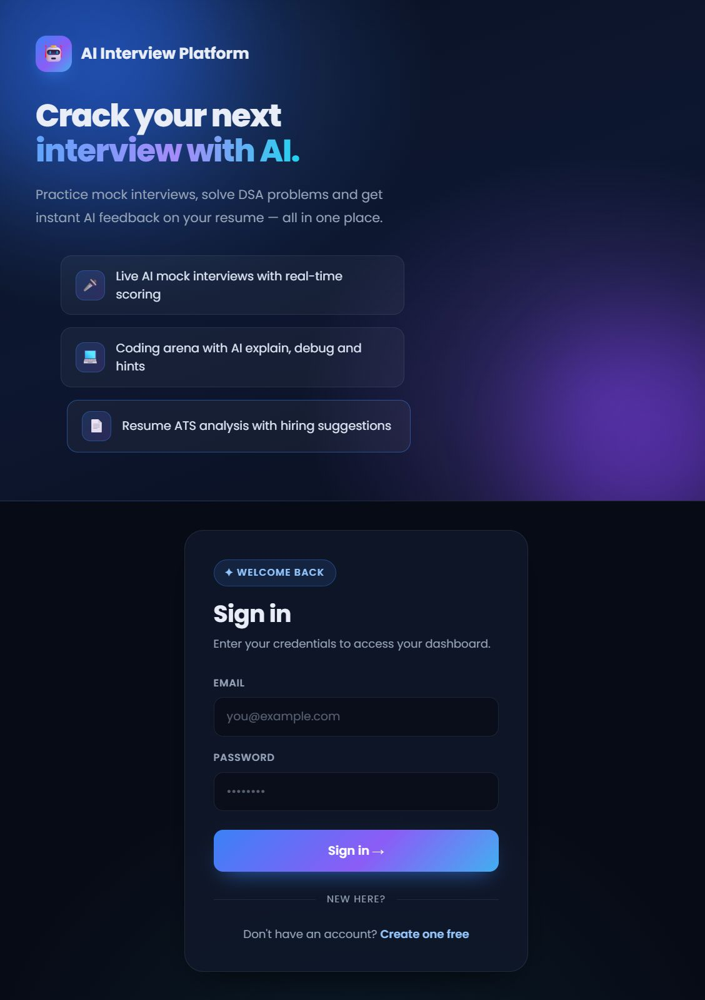 | 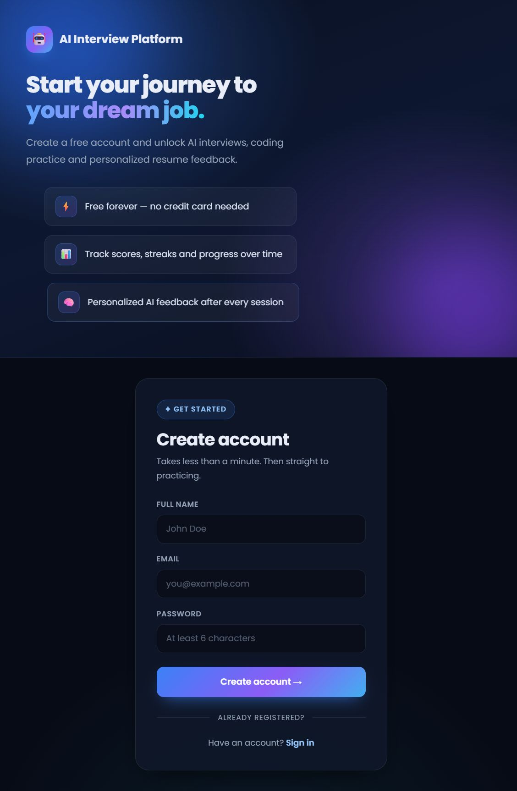 | 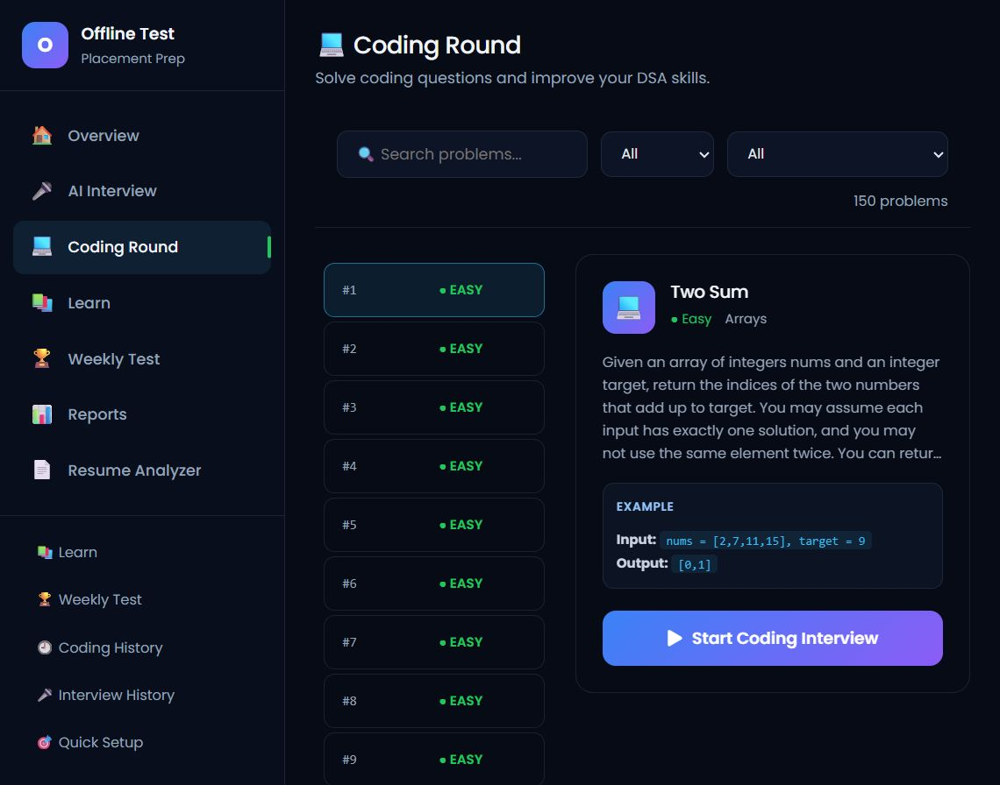 |

## Tech stack

| Layer | Tech |
|---|---|
| Frontend | React 19 · Vite 8 · Monaco Editor · Axios · React Router 7 · Recharts · Framer Motion · Bootstrap 5 · face-api |
| Backend | Java 22 · Spring Boot 3.5 · Spring Security + JWT · Spring Data JPA · H2 (file-based) |
| AI | OpenRouter API (`OPENROUTER_API_KEY`) |
| Build | Maven (`./mvnw`) · npm |

## Project structure

```
.
├── src/                  # React frontend (pages, components, data, services)
│   ├── pages/            # Dashboard, Coding, Learn, WeeklyTest, Interview…
│   ├── components/       # EditorPanel (Monaco + C/C++/Java/Python bridges) …
│   ├── data/             # questions.js, testCases.js, mcqBank.js, learnTopics.js
│   └── hooks/            # useVoiceAssistant
├── backend/              # Spring Boot API
│   └── src/main/java/com/aiml/interviewplatform/
│       ├── controller/   # Auth, Gemini, Submission, Learn, WeeklyTest …
│       ├── service/      # GeminiService, OfflineCodeService, DashboardService …
│       └── dto/ entity/ repository/
├── *.png                 # Screenshots used in this README
└── README.md
```

## Quick start

### Backend (port 8080)

```bash
cd backend
./mvnw spring-boot:run          # or mvnw.cmd on Windows
```

Environment variables:

| Variable | Purpose | Default |
|---|---|---|
| `OPENROUTER_API_KEY` | Required for ALL AI features (interview, learn, resume, hints) | `YOUR_OPENROUTER_API_KEY` (placeholder — set it!) |
| `JWT_SECRET` | JWT signing secret | built-in dev secret |

H2 file database is created automatically at `backend/data/interviewdb` on first run.

### Frontend (port 5173 by default)

```bash
npm install
npm run dev
```

Open http://localhost:5173, click **Create one free**, register, and start practicing. The dev server proxies `/api` → `http://localhost:8080` (see `vite.config.js`); set `VITE_API_URL` to override the API origin.

> Without `OPENROUTER_API_KEY`, the app still runs fully — code execution/grading work offline; every AI feature is disabled gracefully (or the interview falls back to voice-only/offline mode). Set the key to unlock the whole thing.

## Notes

- `backend/data/` (runtime H2 files, user data) is intentionally **not tracked** in this repository — clone and run to create your own.
- The interview room accepts voice answers when a microphone is present; otherwise it falls back to text.
- Weekly Test proctoring requires a webcam and a modern Chromium-based browser.
